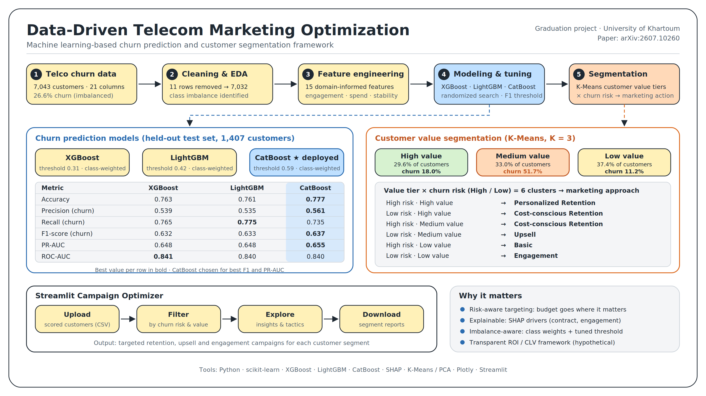
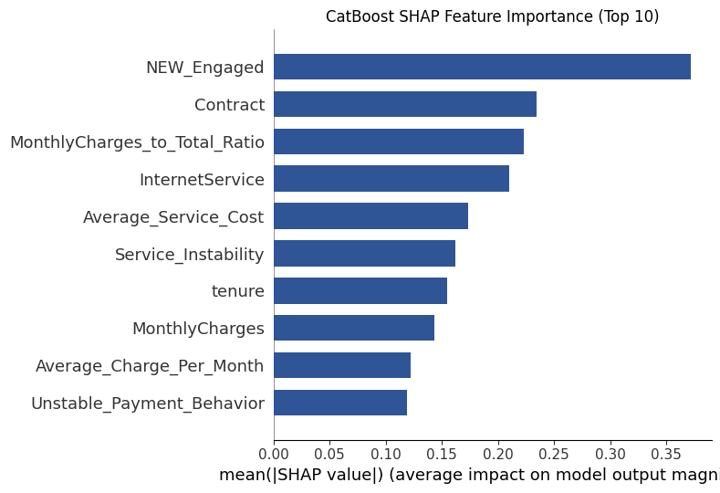
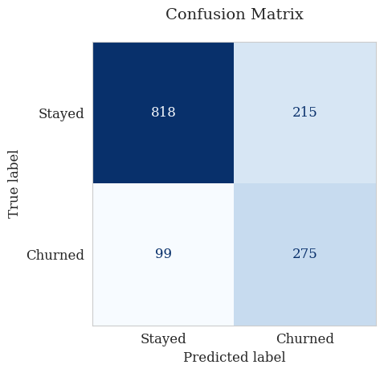
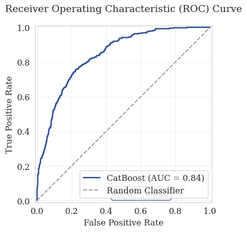
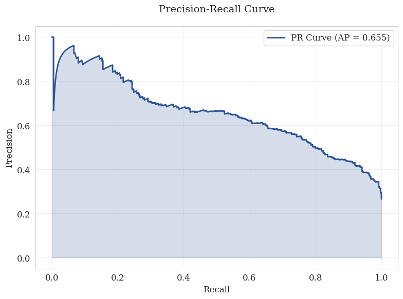
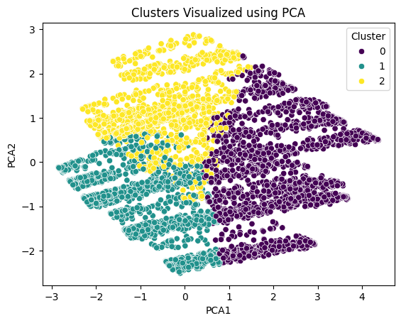
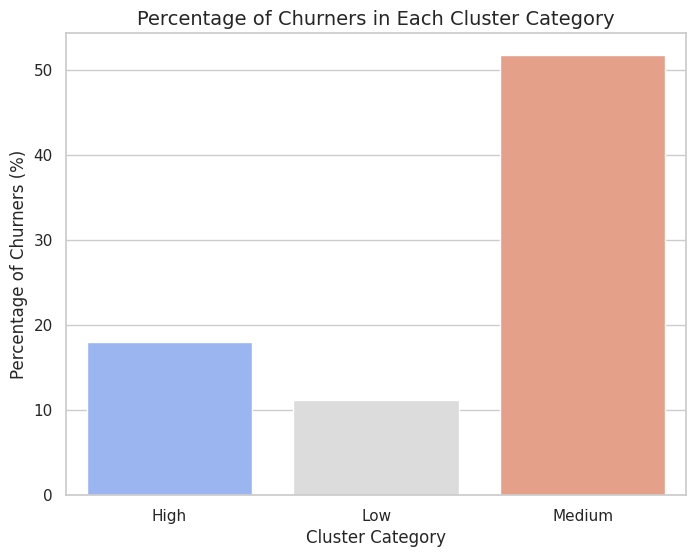

# Data-Driven Telecom Marketing Optimization

### A Machine Learning-Based Churn Prediction and Customer Segmentation Framework


Graduation project, Department of Electrical and Electronic Engineering, **University of Khartoum**.

Most churn projects stop at "who will leave?". This one goes further and answers three questions in a single pipeline: **who** is at risk, **how valuable** each customer is, and **what marketing action** is worth taking, with an interactive app that puts the answers in the hands of a marketing team.

**📄 Paper:** [arXiv:2607.10260](https://arxiv.org/abs/2607.10260) ([HTML](https://arxiv.org/html/2607.10260v1) · [PDF](https://arxiv.org/pdf/2607.10260v1))

<p align="center">
  
</p>

---

## Highlights

- **Tuned gradient-boosting models** (XGBoost, LightGBM, CatBoost) with class weighting and an **F1-optimized decision threshold** instead of the default 0.5 cutoff.
- **CatBoost deployed**: best F1 (0.637) and PR-AUC (0.655) on the held-out test set, ROC-AUC 0.840.
- **15 engineered features** capturing financial stress, service instability and engagement, explained with **SHAP**.
- **K-Means value segmentation** (High / Medium / Low) combined with churn risk into **six actionable customer clusters**, each with its own marketing approach.
- **Streamlit app** for exploring segments, viewing tailored recommendations and downloading segment reports.
- **Transparent ROI / CLV framework** that operators can fill in with their own revenue and campaign costs.

---

## Table of Contents

- [Data-Driven Telecom Marketing Optimization](#data-driven-telecom-marketing-optimization)
    - [A Machine Learning-Based Churn Prediction and Customer Segmentation Framework](#a-machine-learning-based-churn-prediction-and-customer-segmentation-framework)
  - [Highlights](#highlights)
  - [Table of Contents](#table-of-contents)
  - [Pipeline at a Glance](#pipeline-at-a-glance)
  - [Key Results](#key-results)
  - [Visual Results](#visual-results)
  - [Dataset](#dataset)
  - [Methodology](#methodology)
    - [Preprocessing](#preprocessing)
    - [Feature engineering](#feature-engineering)
    - [Training and imbalance handling](#training-and-imbalance-handling)
  - [Customer Segmentation](#customer-segmentation)
  - [Streamlit Application](#streamlit-application)
  - [ROI / CLV Framework](#roi--clv-framework)
  - [Limitations](#limitations)
  - [Getting Started](#getting-started)
  - [Repository Structure](#repository-structure)
  - [Tech Stack](#tech-stack)
  - [Authors](#authors)
  - [Citation](#citation)
  - [Acknowledgments](#acknowledgments)

---

## Pipeline at a Glance

The diagram at the top summarizes the full flow. The two notebooks implement it step by step, and the app puts the results in front of a marketing team.

| Notebook | What it does |
|----------|--------------|
| [`01_eda_baselines_and_segmentation.ipynb`](notebooks/01_eda_baselines_and_segmentation.ipynb) | Data cleaning, EDA, cross-validated comparison of eight classifiers (SMOTE-ENN), and K-Means customer value segmentation with PCA |
| [`02_final_churn_model.ipynb`](notebooks/02_final_churn_model.ipynb) | Feature engineering, hyperparameter tuning, threshold optimization, final evaluation, SHAP and diagnostic plots |

Both notebooks are committed **with their outputs**, so you can browse every result and plot directly on GitHub without running anything.

---

## Key Results

Three gradient-boosting models were tuned with randomized search, stratified 5-fold cross-validation, class weighting and threshold optimization. **CatBoost** was selected for deployment.

**Test-set performance (churn class, 1,407 customers):**

| Model | Accuracy | Precision | Recall | F1 | PR-AUC | ROC-AUC |
|-------|----------|-----------|--------|------|--------|---------|
| XGBoost | 0.7633 | 0.5386 | 0.7647 | 0.6320 | 0.6481 | 0.8408 |
| LightGBM | 0.7612 | 0.5351 | 0.7754 | 0.6332 | 0.6478 | 0.8397 |
| **CatBoost** | **0.7768** | **0.5612** | 0.7353 | **0.6366** | **0.6553** | 0.8403 |

CatBoost was chosen for the best F1 and PR-AUC (the most informative metric under class imbalance), a good precision/recall balance, and native handling of categorical features.

**CatBoost confusion matrix:** 275 true positives · 215 false positives · 99 false negatives · 818 true negatives.

**Top churn drivers (SHAP):** contract and engagement features lead (`NEW_Engaged`, `Contract`), followed by `MonthlyCharges_to_Total_Ratio`, `InternetService`, `Average_Service_Cost`, `Service_Instability` and `tenure`. Several engineered features rank in the top ten.

---

## Visual Results

<table>
  <tr>
    <td align="center"><b>SHAP feature importance (CatBoost)</b><br></td>
    <td align="center"><b>Confusion matrix (CatBoost)</b><br></td>
  </tr>
  <tr>
    <td align="center"><b>ROC curve</b><br></td>
    <td align="center"><b>Precision-recall curve</b><br></td>
  </tr>
  <tr>
    <td align="center"><b>Customer value segments (PCA)</b><br></td>
    <td align="center"><b>Churn rate by value segment</b><br></td>
  </tr>
</table>

<!-- Add Streamlit screenshots here once saved to docs/images/, for example:

-->

---

## Dataset

- **Source:** [IBM Telco Customer Churn on Kaggle](https://www.kaggle.com/datasets/blastchar/telco-customer-churn)
- **Size:** 7,043 customers, 21 columns (customer ID, demographics, subscribed services, account details, charges, churn label)
- **Target:** `Churn` (Yes/No): 26.6% churn vs. 73.4% non-churn
- **Download:** see [`data/README.md`](data/README.md)

**Known dataset limitations:** class imbalance, a single time snapshot (no seasonality), no external market variables, and a binary label that cannot capture partial service reduction.

---

## Methodology

### Preprocessing
- Dropped `customerID`
- Converted `TotalCharges` to numeric and removed the **11 rows** with missing values (all have `tenure = 0`), leaving **7,032 customers**
- One-hot encoding for XGBoost and LightGBM; native categorical handling for CatBoost
- Stratified 80/20 train/test split

### Feature engineering
Fifteen domain-informed features, for example `NEW_Engaged`, `Total_Active_Services`, `Average_Charge_Per_Month`, `AutoPayment_Usage`, `Unstable_Payment_Behavior`, `HighRisk_Low_Tenure`, `Service_Instability` and `HighSpend_LowTenure`. The full feature set is implemented in `preprocess_data` in notebook 02.

### Training and imbalance handling
- `RandomizedSearchCV` with stratified 5-fold CV, optimizing average precision (PR-AUC)
- Class weighting via `scale_pos_weight` (searched at the raw ratio of 2.76, its square root, and small values)
- **Threshold search** over 100 values in [0.1, 0.9], maximizing F1 under a minimum precision/recall constraint, rather than using 0.5
- Explainability with **SHAP**

---

## Customer Segmentation

Customers are clustered by value with **K-Means** (K = 3, chosen with the elbow method) on tenure, charges and service-adoption features, then visualized with PCA.

| Value segment | Share of customers | Churn rate |
|---------------|--------------------|-----------|
| High-Value | 29.6% | 18.0% |
| Medium-Value | 33.0% | 51.7% |
| Low-Value | 37.4% | 11.2% |

Combining value with predicted churn risk gives six clusters, each mapped to a general marketing approach (detailed tactics live in [`app/marketing_strategies.py`](app/marketing_strategies.py)):

| Churn risk | Customer value | General approach | Idea |
|------------|----------------|------------------|------|
| High | High | **Personalized Retention** | High-touch offers: free service months, exclusive streaming perks, flexible payment plans |
| Low | High | **Cost-conscious Retention** | Scalable loyalty: automated communication, loyalty discounts, contract upgrades |
| High | Medium | **Cost-conscious Retention** | Tiered incentives, bundles, payment-method incentives |
| Low | Medium | **Upsell** | Bundles, underused services (e.g. online security), loyalty rewards |
| High | Low | **Basic** | Small discount, free streaming month, referral program |
| Low | Low | **Engagement** | Lightweight engagement: surveys, referral and loyalty programs |

**Insight:** the Medium-Value segment has by far the highest churn rate (51.7%), while high-risk, high-value customers are a small group with the greatest financial exposure per customer.

---

## Streamlit Application

An interactive **Telecom Marketing Campaign Optimizer** for marketing analysts who do not want to touch notebooks.

**Features**
- CSV upload (drag and drop)
- Filters by churn-risk level and customer-value segment
- Key metrics: customer count, total monthly charges, average tenure
- Interactive Plotly charts that update per segment
- Segment-specific marketing recommendations
- Preview and download of the data
- One-click downloadable segment report (`.txt`)

The app reads a **pre-scored** customer file: churn-risk labels and value segments are computed beforehand, not inside the app. The scored file is included at [`app/sample_data/telco_scored_customers.csv`](app/sample_data/telco_scored_customers.csv), so the app can be tried right away.

```bash
cd app
streamlit run Home.py
```

---

## ROI / CLV Framework

Because proprietary financial data was unavailable, the project provides a transparent, adjustable framework that operators can fill in with their own ARPU and campaign costs:

- **Estimated lifetime:** `Lifetime = 12 / Predicted Annual Churn Rate`
- **Intervention effect:** `Lifetime_ext = Lifetime_base × (1 + e)`, with efficacy `e` in [0.15, 0.30]
- **Discounted CLV:** `CLV = Σ R_t · (1 − Churn_t) / (1 + d)^t`
- **Campaign ROI:** `ROI = (ARPU × Lifetime_ext − Campaign Cost) / Campaign Cost`

> ⚠️ The ROI figures in the paper are **hypothetical scenarios**, not results from live A/B-tested campaigns.

---

## Limitations

- The dataset is a static snapshot with no temporal or competitor signals.
- The scored file used by the app covers all 7,032 customers, including those the model was trained on; use the held-out test results above as the performance estimate.
- CLV estimates rely on simplified linear-churn and uniform-ARPU assumptions.
- ROI outcomes are theoretical simulations.
- The app supports fixed visualization types and single-user sessions, with no role-based access or CRM integration.

**Future directions:** real-time behavioral streams and survival-based churn models, reinforcement learning for campaign allocation, extension to other subscription industries, and multi-user access.

---

## Getting Started

```bash
# 1. Clone the repository
git clone https://github.com/<your-username>/telecom-churn-marketing-optimization.git
cd telecom-churn-marketing-optimization

# 2. (Optional) create a virtual environment
python -m venv venv
source venv/bin/activate        # Windows: venv\Scripts\activate

# 3. Install dependencies
pip install -r requirements.txt

# 4. Download the dataset into data/ (see data/README.md), then open the notebooks
jupyter notebook notebooks/

# 5. Launch the app
cd app && streamlit run Home.py
```

**Google Colab:** upload the dataset to the Colab session, then run the notebooks in order (01, then 02). See [`data/README.md`](data/README.md) for the expected file paths.

> Notebook 02 pins `scikit-learn==1.5.2` in its first cell, because some boosting libraries had compatibility issues with scikit-learn 1.6 when the results were produced.

---

## Repository Structure

```
.
├── README.md
├── requirements.txt
├── notebooks/
│   ├── 01_eda_baselines_and_segmentation.ipynb
│   └── 02_final_churn_model.ipynb
├── app/
│   ├── Home.py                        # Streamlit entry point
│   ├── marketing_strategies.py        # Tactics per (risk, value) segment
│   ├── segment_report.py              # Downloadable segment report
│   └── sample_data/
│       └── telco_scored_customers.csv # Scored customers used by the app
├── data/
│   └── README.md                      # How to get the dataset
└── docs/
    └── images/                        # Figures used in this README
```

---

## Tech Stack

- **Language:** Python
- **Modeling:** CatBoost, XGBoost, LightGBM, scikit-learn, imbalanced-learn
- **Explainability:** SHAP
- **Clustering:** K-Means, PCA
- **Data and visualization:** pandas, NumPy, Plotly, Matplotlib, Seaborn
- **Deployment:** Streamlit

---

## Authors

| Name | Role | Links |
|------|------|-------|
| **Nada Ali** | Author |  [LinkedIn](https://www.linkedin.com/in/nada-ali-0651a6261/) |
| **Lina Ahmed** | Author |  [LinkedIn](https://www.linkedin.com/in/lina-ahmed-alnoosh-0b2085159/) |
| **Dr. Tahani Abdalla Attia** | Supervisor, Associate Professor | [LinkedIn](https://www.linkedin.com/in/tahaniattia/)  |

---

## Citation

If you use this work, please cite the paper:

```bibtex
@article{ali2026telecom,
  title   = {Data-Driven Telecom Marketing Optimization: A Machine Learning-Based Churn Prediction and Customer Segmentation Framework},
  author  = {Ali, Nada and Ahmed, Lina and Attia, Tahani Abdalla},
  journal = {arXiv preprint arXiv:2607.10260},
  year    = {2026}
}
```

---

## Acknowledgments

- Dataset: [IBM Telco Customer Churn](https://www.kaggle.com/datasets/blastchar/telco-customer-churn) on Kaggle
- University of Khartoum, Department of Electrical and Electronic Engineering
